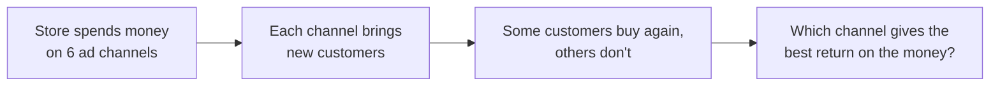
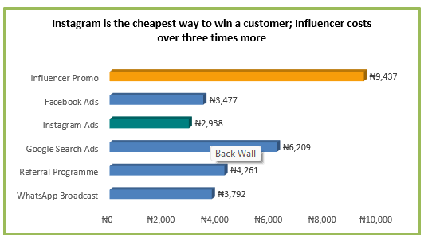
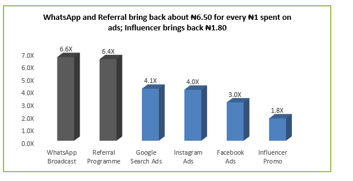
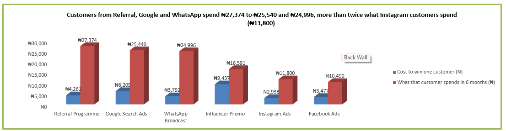
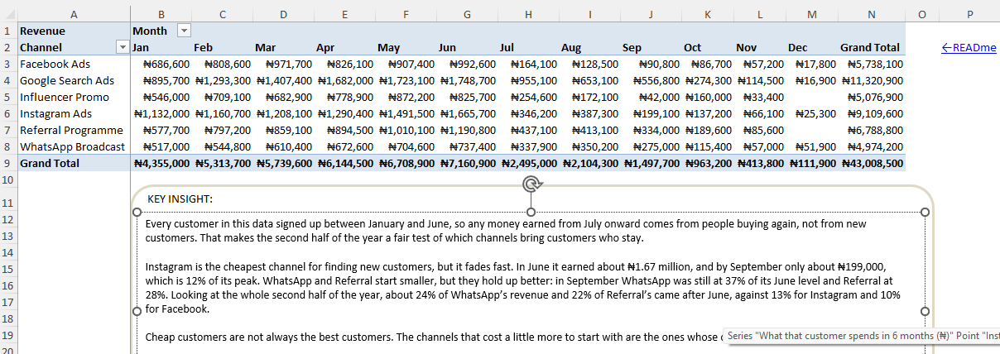

<h1>📊 Marketing Channel Analysis</h1>

**Finds which advertising channel gives an online store the best return, and shows how to move the budget to earn more.**

**[📁 Open the workbook](excel/marketing-channel-analysis.xlsx)** · **[🧱 How it was built](#4-methodology)**

---

## 1. Title

**Marketing Channel Analysis: an Excel analysis (descriptive and diagnostic) for an online fashion retailer in Nigeria**

| | |
|---|---|
| **Type of analysis** | Descriptive (what happened) and diagnostic (why some channels do better), with a what-if budget scenario |
| **Industry** | Retail and e-commerce, marketing analytics |
| **Tool** | Microsoft Excel only (Tables, XLOOKUP, SUMIFS, COUNTIFS, PivotTables, charts) |
| **Data** | Synthetic practice data: 2,517 customers who joined January to June 2025, followed for six months |

---

## 2. Executive summary

- **Business problem.** An online store buys new customers through six advertising channels. It does not know which channel is worth the money, so it cannot decide where to put the next quarter's budget.
- **Solution.** I cleaned and joined the customer, order and ad-spend data in Excel, measured each channel on cost per customer, what customers spend, how often they buy again and return on ad spend, then tested a budget shift in a scenario sheet.
- **Impact.**

| Result | Figure |
|---|---|
| Total ad spend | **₦11,632,400** |
| Total revenue from these customers | **₦43,008,500** |
| Overall return on ad spend | **3.7x** (₦3.70 back for every ₦1 spent) |
| Best channel (return) | **WhatsApp, 6.6x** |
| Worst channel | **Influencer, 1.8x** (loses about ₦1.1 million after margin) |
| Profit after ads now → after moving 20% of two budgets | **₦3.42 million → up to ₦4.85 million** |

- **Next steps.** Run the budget shift as a one-quarter test, repeat the analysis on real data, and track profit after ads instead of cost per customer alone. [Details in section 7.](#7-next-steps)

### ⭐ What makes this project stand out
1. **It reaches a decision, not just a chart.** The scenario sheet turns the findings into a budget recommendation.
2. **The cheapest channel is not the best.** Instagram wins on cost per customer, but customers from other channels spend more and come back more often.
3. **It shows the reasoning.** Each finding follows *What I saw → Why I think so → What I would do*.
4. **It tests the recommendation honestly.** The scenario includes a worst case where the moved money earns nothing.
5. **It says what it cannot prove.** The data is synthetic and the margin is an assumption, both stated up front.

---

## 3. Business problem

**How the business works.** The store sells fashion online across Nigeria. It advertises on Instagram, Facebook, Google, through influencers, through a referral programme and by WhatsApp broadcast. Each customer arrives through one channel and may buy more than once over the following months.

**The questions.**
1. How much does it cost to win a customer in each channel?
2. How much does each customer spend, and how many come back?
3. Which channels make a profit after paying for the ads?
4. Where should next quarter's budget go?

**Why I chose this problem.**
<!-- Edit this section in your own words. -->
- Every business with an advertising budget has to decide where the next naira goes.
- Cost per customer looks like the obvious measure, but it can point to the wrong answer, so it is a good test of careful analysis.
- It let me show a full analysis in Excel, from raw tables to a recommendation.

---

## 4. Methodology

**Approach:** comparison of channels using cost per customer, customer value, repeat buying and return on ad spend, followed by a what-if scenario.

| Step | What I did in Excel |
|---|---|
| 1. Load and structure | Turned each data sheet into an Excel Table (`tbl_channels`, `tbl_customers`, `tbl_spend`, `tbl_orders`) |
| 2. Check the data | Checked for duplicates, blanks and real dates, and recorded each check (see the data log below) |
| 3. Join the tables | Used `XLOOKUP` to attach the channel name to customers, orders and spend |
| 4. Calculate | Used `COUNTIFS` and `SUMIFS` for customers, spend and revenue, then built cost per customer, return on ad spend, revenue per customer and repeat rate |
| 5. Explore | Built a PivotTable of revenue by channel and month to see repeat buying over time |
| 6. Model profit | Added a margin assumption (35%) to get profit after ads |
| 7. Test a decision | Built a scenario sheet that moves budget between channels |
| 8. Explain | Made three charts and a findings sheet |

**How each measure is worked out:**
- **Cost per new customer** = ad spend ÷ new customers
- **Return on ad spend (ROAS)** = revenue ÷ ad spend. Overall ROAS is total revenue ÷ total spend, *not* the average of the channel figures
- **Revenue per customer** = revenue ÷ new customers
- **Repeat rate** = customers with two or more orders ÷ new customers
- **Profit after ads** = revenue × 35% margin − ad spend

### Workbook guide
| Sheet | What it holds |
|---|---|
| `README` | Short description of the data |
| `channels`, `customers`, `marketing_spend`, `orders` | The raw data, as Tables |
| `Summary` | One row per channel with every measure above |
| `Pivot` | Revenue by channel and month |
| `Chart data` and charts | The clean tables behind the three charts |
| `Scenario` | The budget-shift what-if |
| `Findings` | The three-sentence findings and the limits |

### Data checks (fill in your own results)
| Check | How | Result |
|---|---|---|
| Duplicate customers | Data > Remove Duplicates on `customer_id` | [none found / n removed] |
| Blank cells | Filter each column for blanks | [none found / n fixed] |
| Dates are real dates | Cells right-align; `=ISNUMBER(cell)` | [passed] |
| Every order has a customer | `XLOOKUP` returns no `#N/A` | [passed] |
| Channel totals add up | Sum of channels = grand total | [passed] |

**About the data.** All data is **synthetic**, invented for this practice project. It does not describe a real store or real customers.

### Run it yourself
1. Download `excel/marketing-channel-analysis.xlsx`.
2. Open the `Summary` sheet to see the results, then the `Scenario` sheet and change the cells in the top-left to test other budget shifts.
3. Excel 365 or Excel 2021 is needed for `XLOOKUP`.

---

## 5. Skills

| Area | What I did in this project |
|---|---|
| **Data cleaning** | Checked for duplicates, blanks and wrong date formats, and logged each check |
| **Excel formulas** | `XLOOKUP`, `SUMIFS`, `COUNTIFS`, `IF`, structured Table references |
| **Summarising data** | PivotTables grouped by month, summary tables, conditional formatting |
| **Analysis** | Cost per customer, return on ad spend, repeat rate, profit after ads, break-even thinking |
| **Modelling** | A what-if scenario with an adjustable budget shift and an adjustable return on the moved money |
| **Visual communication** | Charts with plain-language titles that state the finding |
| **Communication** | Findings and recommendations written in plain language with the limits stated |

---

## 6. Results and business recommendations

### The channels side by side

| Channel | Ad spend | New customers | Cost per customer | Spend per customer (6 months) | Repeat rate | Return on ad spend | Profit after ads |
|---|---|---|---|---|---|---|---|
| WhatsApp Broadcast | ₦754,700 | 199 | ₦3,792 | ₦24,996 | 44% | **6.6x** | ₦986,270 |
| Referral Programme | ₦1,056,700 | 248 | ₦4,261 | ₦27,374 | 42% | **6.4x** | ₦1,319,380 |
| Google Search Ads | ₦2,763,200 | 445 | ₦6,209 | ₦25,440 | 34% | 4.1x | ₦1,199,115 |
| Instagram Ads | ₦2,268,400 | 772 | ₦2,938 | ₦11,800 | 18% | 4.0x | ₦919,960 |
| Facebook Ads | ₦1,901,700 | 547 | ₦3,477 | ₦10,490 | 16% | 3.0x | ₦106,635 |
| Influencer Promo | ₦2,887,700 | 306 | ₦9,437 | ₦16,591 | 19% | 1.8x | −₦1,110,785 |
| **Total** | **₦11,632,400** | **2,517** | | | | **3.7x** | **₦3,420,575** |

### Charts

### Key findings
1. **The cheapest channel is not the best one.** Instagram costs ₦2,938 per customer, but returns only ₦4.0 for every ₦1 spent, while WhatsApp and Referral return ₦6.6 and ₦6.4.
2. **Customers from some channels are worth far more.** Instagram customers spend about ₦11,800 in six months, against about ₦25,000 to ₦27,000 for WhatsApp, Referral and Google customers. Only 18% of Instagram customers buy again, against 44% for WhatsApp and 42% for Referral.
3. **Repeat buying lasts longer in the better channels.** From July onwards no new customers arrive, so revenue after June is repeat buying. About 24% of WhatsApp's revenue and 22% of Referral's came after June, against 13% for Instagram. By September, Instagram earned 12% of what it earned in June, against 37% for WhatsApp and 28% for Referral.
4. **Influencer promotions lose money.** After a 35% margin the channel loses about ₦1.1 million. It would need a margin above about 57% to break even, and Facebook only breaks even at a margin above about 33%.

### Recommendations

| # | Because… | I recommend… | I'd measure it by… |
|---|---|---|---|
| 1 | Influencer loses about ₦1.1 million and Facebook barely breaks even | moving 20% of the Influencer and Facebook budgets (about ₦958,000) to Referral and WhatsApp for one quarter | profit after ads for each channel |
| 2 | the cheapest channel brings the least valuable customers | judging channels by profit after ads, not cost per customer alone | profit per customer and repeat rate |
| 3 | better channels keep earning after the first purchase | counting repeat purchases when comparing channels | revenue after the first month, by channel |

### What the budget shift could do
| If the moved money earns… | Profit after ads |
|---|---|
| the same as it does today | about **₦4.85 million** (from ₦3.42 million) |
| half as much | about ₦4.23 million |
| nothing at all | about ₦3.62 million |

Even in the worst case profit rises, because cutting the Influencer loss saves more than the cut to Facebook costs. **The best case assumes each channel keeps its return at a bigger budget, which usually does not hold in real life.**

### Limitations
- The data is synthetic. The results show how I analyse a problem, not how a real store performs.
- The 35% margin is an assumption.
- Customers were followed for six months only.
- The analysis shows patterns, not proof that a channel *caused* the results.

---

## 7. Next steps

**Limitations I would fix**
- **Use real data** from a store's own customers, orders and ad accounts.
- **Add real margins per product**, instead of a single 35% assumption.
- **Follow customers for longer** than six months to see the full value of each channel.

**What I would work on with more time**
- Run the budget shift as a controlled test for one quarter and compare it with the plan.
- Add a test of whether returns fall as spend rises, using several budget levels.
- Add slicers and a one-page dashboard sheet so a manager can filter by month, state and channel.
- Use Power Query so that new months of data refresh the whole workbook automatically.
- Add the cost of discounts and delivery to the profit calculation.

---

**Built by [Your Name]** · Data Analyst
[LinkedIn](www.linkedin.com/in/julde-toheed) · [Email](mailto:juldetoheed@gmail.com) · [Portfolio](ADD-YOUR-PORTFOLIO-LINK-HERE)

